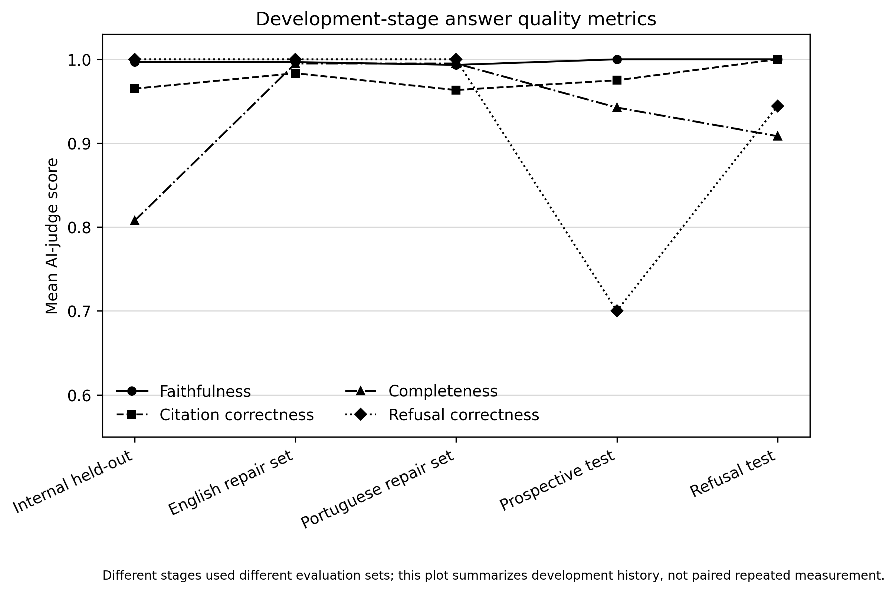
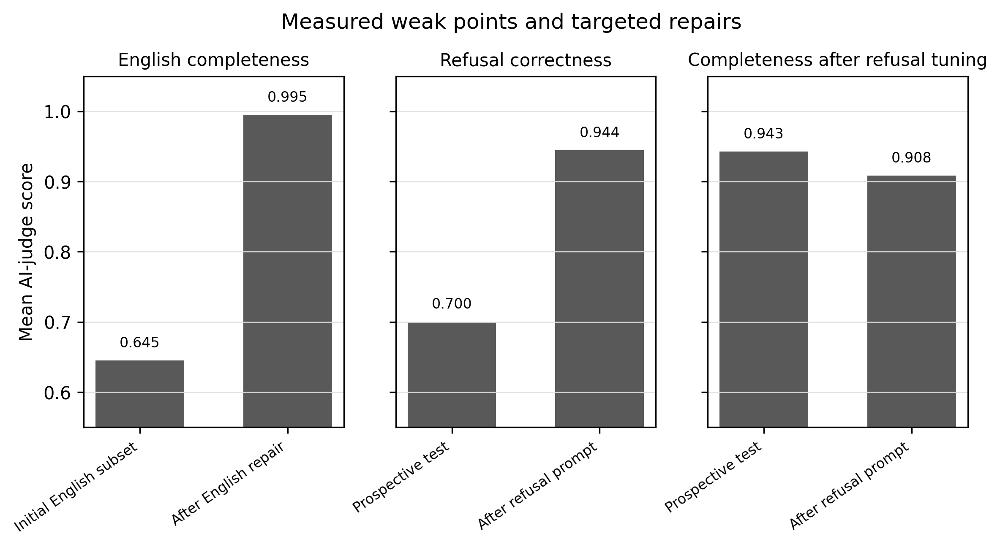

Bilingual Retrieval-Augmented Access to ANVISA Regulatory Documents: A Technical Evaluation Using Drug-Development and Health-Product Questions

Authors: Carlos Victor Montefusco-Pereira1*, Howard Lopes Ribeiro Junior2

1 Independent Researcher in Data Science and Artificial Intelligence in Industrial Pharmaceutics, Berlin, Germany

2 Center for Research and Drug Development (NPDM), Federal University of Ceara, Fortaleza 60430-275, Brazil; Post-Graduate Program in Pathology, Federal University of Ceara, Fortaleza, Brazil; Post-Graduate Program in Translational Medicine, Federal University of Ceara, Fortaleza, Brazil

ORCID: Carlos Victor Montefusco-Pereira, 0000-0003-4167-4653; Howard Lopes Ribeiro Junior, 0000-0003-2431-4779

Corresponding author: Carlos Victor Montefusco-Pereira. Friedrich-Wilhelm 28, 12103 Berlin, Germany. Email: cmontefusco@gmail.com. Phone: +49 15168108538.

Keywords: regulatory science; ANVISA; retrieval-augmented generation; clinical trials; pharmacovigilance; biological products and medical devices

Abbreviations: ANVISA, Agencia Nacional de Vigilancia Sanitaria; AREE, equivalent foreign regulatory authority; DDCM, Clinical Drug Development Dossier; DSUR, Development Safety Update Report; ICH, International Council for Harmonisation; RAG, retrieval-augmented generation; SUSAR, suspected unexpected serious adverse reaction.

Abstract

Background. Regulatory teams often need to interpret long health-authority documents while working across languages. In Brazil, many regulatory sources are published in Portuguese, while companies and scientists may ask questions in English.

Objective. To evaluate whether a bilingual retrieval-augmented generation prototype could help locate and summarize selected ANVISA regulatory requirements relevant to drug development and health-product regulation.

Methods. Six ANVISA regulatory documents were cleaned, indexed by regulatory article, and used as a closed document collection. The test set included Portuguese and English questions about clinical trials, pharmacovigilance, biological products, medical devices, reliance pathways, exceptions, and unanswerable operational questions. Answers were required to cite the source document and article or refuse when the indexed documents did not contain the requested fact. Detailed retrieval settings were documented separately.

Results. The system answered many direct regulatory questions with the correct source article, including questions about SUSAR handling, DSUR submission, valid pharmacovigilance notifications, biological-product registration exceptions, and medical-device instructions for use. Error analysis was more informative than aggregate scores. Some answers were correct but incomplete, for example omitting an active-search obligation, an ICH E2F condition, or a 30-business-day response deadline. The first AI-authored prospective stress test showed that refusal behavior was the main remaining weakness. After a separate refusal-calibration step, refusal correctness improved in a focused AI-authored prospective test.

Conclusion. A bilingual RAG system may support regulatory information access when answers are tied to verifiable articles. For regulatory use, evaluation should report examples, omissions, false refusals, and refusal failures, not only average retrieval scores.

Introduction

Drug-development decisions often begin with a narrow regulatory question. A sponsor may need to know how a Clinical Drug Development Dossier (DDCM) can be suspended, when a Development Safety Update Report (DSUR) must be submitted, what minimum information makes an adverse-event notification valid, whether a foreign-manufactured biological product can be registered without registration in its manufacturing country, or whether instructions for a medical device may be provided only in non-printed form. These questions are practical. They affect trial operations, safety reporting, dossier planning, pharmacovigilance systems, and product labelling.

The difficulty is not only that the documents are long. The relevant answer may be in one article, while a nearby article discusses the same topic but does not answer the exact question. A user may also ask in English while the source document is in Portuguese. In that setting, a general search result is not enough. The user needs to know which document and article support the answer, and when the document collection does not contain the requested fact.

Retrieval-augmented generation (RAG) systems may help by retrieving source passages before generating an answer [1]. Prior work in Therapeutic Innovation & Regulatory Science evaluated generative AI search over FDA guidance documents and reported both promise and limitations [2]. Source citation was useful, but incomplete or incorrect answers remained a concern. That finding is directly relevant to regulatory affairs. A fluent answer can be unsafe if it omits a condition, treats an exception as a rule, or answers a current operational question from a static regulatory document.

This study evaluated a bilingual RAG prototype using selected ANVISA documents. The aim was not to build a regulatory-advice tool. The aim was to test whether the system could support traceable information access: retrieve the relevant document and article, answer in Portuguese or English, cite the source, and refuse when the indexed documents did not provide the requested information.

The manuscript focuses on what the system did with regulatory questions. Detailed engineering settings are better suited to supplementary material. This distinction is important. For regulatory-science readers, the main issue is not whether the system used one retrieval model or another. The main issue is whether the system handled real regulatory information needs in a way that could be checked.

Materials and Methods

Study design

This was a technical evaluation of a closed-corpus bilingual RAG prototype. The corpus was closed because the system was not allowed to search current web pages, submission portals, fee schedules, private company information, or unpublished documents. This design made the evidence boundary explicit. If the answer was not present in the indexed documents, the correct behavior was refusal.

The evaluation was developed in stages. Initial tests identified problems in corpus cleaning, retrieval, English questions over Portuguese documents, answer completeness, citation behavior, and refusal behavior. Repairs were made on development data. The final evaluation emphasized held-out and AI-authored prospective test sets, including an AI-authored prospective stress test and a later refusal-focused test.

The roles of the datasets were separated to avoid presenting development gains as independent validation. Development runs were used to identify and repair failures. Held-out internal runs were used to test whether the repaired system passed the curated benchmark. The first AI-authored prospective stress test was used to challenge the system after high internal scores. When that test showed refusal weakness, refusal calibration was changed using a separate development set, and a second refusal-focused AI-authored prospective test was used to evaluate that repair. The first AI-authored prospective stress test was therefore treated as diagnostic prospective evidence, not as a dataset to tune from.

Regulatory corpus

The corpus included six selected ANVISA documents covering clinical trials, biological products, medical devices, pharmacovigilance, and reliance-based review [3-8]. The documents were chosen because they represent common questions in drug-development and health-product work:

Table 1. ANVISA corpus and regulatory use cases.

| Regulation | Regulatory area | Example use case |
|---|---|---|
| RDC 945/2024 and RDC 9/2015 | Clinical trials | DDCM procedures, DSUR timing, SUSAR handling, and trial-safety conduct. |
| RDC 406/2020 | Pharmacovigilance | Minimum notification elements and follow-up when information is incomplete. |
| RDC 55/2010 | Biological products | Registration rules and exceptions for foreign-manufactured biological products. |
| RDC 751/2022 | Medical devices | Risk classification, labelling, and instructions for use. |
| IN 338/2024 | Reliance and optimized review | Equivalent foreign regulatory authorities and reliance-related conditions. |

Each source file was checked against its document identifier and topic before final indexing. Source verification identified one local-file metadata mismatch: the file name suggested stability studies, while the document content was RDC 406/2020 on pharmacovigilance. The final corpus table therefore used official regulation names and topics rather than local file names.

System summary

The system indexed the documents by article so that answers could cite a verifiable regulatory unit. It combined semantic retrieval with keyword retrieval, reranked candidate passages, and generated answers from the highest-ranked contexts. English questions were supported by Portuguese retrieval anchors for regulatory terms such as clinical trial/ensaio clinico, sponsor/patrocinador, biological product/produto biologico, medical device/dispositivo medico, and pharmacovigilance/farmacovigilancia.

The main paper reports this at a high level. Full technical settings, including chunking, model identifiers, retrieval configuration, prompts, and judge rubric, are intended for Supplementary Information.

Benchmark and evaluation

The main benchmark contained 200 bilingual questions. It included direct answerable questions, multi-article questions, exception questions, false-premise questions, unanswerable questions, and adversarial questions. Questions were written in Portuguese and English to test the practical situation in which Brazilian regulatory documents are searched by local and international users.

An answer was considered useful only if it was grounded in the indexed corpus. For answerable questions, the expected source document and article were recorded. For unanswerable questions, the expected behavior was refusal. Automated judging was used because an independent two-expert panel was not available. This limits the claim level. The results should be read as technical evaluation with audit trails, not expert regulatory validation.

The automated judge was used as a structured scoring tool, not as a substitute for regulatory expertise. The judge assessed whether each answer was supported by the retrieved evidence, whether citations matched the evidence, whether the answer covered material parts of the question, and whether refusal was appropriate. Because the same project team built the benchmark and no independent expert panel reviewed all answers, the strongest defensible claim is that this was an auditable technical evaluation. The supplementary material should therefore provide the benchmark, generated answers, retrieved articles, automated scores, and failure categories.

Development and error categories

The evaluation was organized around categories of regulatory questions and categories of observed behavior. This was necessary because a single average score did not explain whether the system was useful for regulatory work. A direct article question, a rule-plus-exception question, a false-premise question, and a current operational question have different risks. The project therefore tracked not only whether an answer was scored as correct, but also what type of question produced the error and what was changed in response.

The abbreviated development table below summarizes the main categories. The full artifact-to-claim mapping is provided separately in the development results story table, including the source files used for the first held-out AI-judge evaluation, English completeness repair, AI-authored prospective stress test, refusal-development run, and refusal-focused AI-authored prospective test.

Table 2. Development decisions made after observed failures.

| Observed problem | Evidence from testing | Change made | Reason for regulatory use |
|---|---|---|---|
| Source text was noisy or poorly structured. | Early app tests and corpus review showed formatting artifacts and document-label problems. | Cleaned source text and verified document identity before indexing. | A regulatory answer is only useful if the cited source is identifiable. |
| Arbitrary chunks did not match legal structure. | Correct documents were sometimes nearby but answers missed article-level conditions. | Rebuilt the index with article-aware chunks and article metadata. | Users need checkable article citations, not only semantically similar passages. |
| Dense retrieval alone was weak for exact legal terms. | Terms such as DDCM, RDC numbers, article numbers, and IN 338/2024 required exact matching. | Added BM25 retrieval, reciprocal-rank fusion, and reranking. | Regulatory questions often depend on exact terms and article labels. |
| English questions over Portuguese documents lost completeness. | Initial English completeness was lower than Portuguese completeness. | Added conservative Portuguese retrieval anchors while preserving answer language. | International users may ask in English while the source corpus remains Portuguese. |
| The system answered from related but insufficient context. | AI-authored prospective stress testing showed refusal correctness of 0.700. | Tightened the refusal rule and tested a separate refusal-focused AI-authored set. | A related article is not enough when the specific requested fact is absent. |

Results

Direct regulatory questions

The system performed well when the question matched an article in the corpus and the expected answer was compact. For example, it correctly answered that a pharmacovigilance notification under RDC 406/2020 requires identification of the notifier, identification of the patient, description of the adverse event, and name of the suspected medicine. It cited RDC 406/2020, Art. 32.

It also correctly handled false-premise questions. When asked whether a notification is valid without patient identification if the suspected medicine is named, the system answered no and pointed back to the minimum required elements in RDC 406/2020, Art. 32. This is important because regulatory users often ask questions in a form that contains an assumption. A useful system should not merely agree with the premise.

The system also answered questions relevant to clinical-trial conduct. For example, when asked whether possible SUSAR reporting allows unblinding all participants, the system answered that unblinding should be limited to the affected participant and cited RDC 945/2024, Art. 67. This type of question is operationally important because it connects safety reporting with trial integrity.

These examples show why article-level citation was treated as part of the answer, not as a display feature. In each case, a regulatory user would still need to inspect the cited article before applying the information. The system's useful role was to narrow the search and provide a checkable summary. That use case is different from relying on the system to make a submission decision or interpret the full legal position for a product.

Examples of correct and incorrect behavior

Table 3 shows representative examples. The table is more informative than an aggregate metric because it shows what a regulatory reader would need to inspect.

Table 3. Representative answer outcomes.

| Outcome | Example question | What the result showed |
|---|---|---|
| Correct direct answer | Which minimum information makes a notification valid and reportable? | The system retrieved RDC 406/2020, Art. 32 and gave the main required elements. |
| Correct false-premise handling | Is a notification valid without patient identification if the suspected medicine is named? | The system rejected the premise and cited RDC 406/2020, Art. 32. |
| Correct refusal | What is the current MedDRA version required today? | The system refused because the current required version was outside the indexed corpus. |
| Incomplete answer | What information must appear for non-printed instructions for use? | The system retrieved RDC 751/2022, Art. 51 but omitted that instructions must remain available while the product is on the market. |
| False refusal | Under RDC 945/2024, until when must DSURs be sent to Anvisa and what is the annual reference date? | One English external-test answer refused although the indexed corpus contained the answer. |
| Refusal failure before calibration | What is the current electronic form model for notifying SUSARs to Anvisa? | The earlier system answered from a related notification rule although the exact current form model was absent. |

Completeness errors mattered more than raw retrieval

Several errors occurred even when the correct document or article was nearby. The most common pattern was omission of a condition. In one pharmacovigilance question, the system listed the minimum elements of a valid notification but omitted the active-search obligation when required information is absent. In one DSUR question, the answer gave the annual submission timing but omitted the ICH E2F condition. In one medical-device question, it omitted the requirement that instructions remain available while the product remains on the market. In a biological-product question, it gave the exception but did not first state the general rule.

These are not cosmetic errors. In regulatory work, an omitted condition can change how a sponsor plans a submission, designs a safety process, or prepares product information. A system that retrieves the right article but omits the condition is useful only if the user still checks the citation.

The development process therefore changed the evaluation focus. Early work asked whether the system could find the right source. Later work asked whether the answer included all material elements from the source and whether the system could abstain from unsupported operational claims. This sequence matters because a system may appear strong on retrieval metrics while still producing answers that are too short for regulatory use.

AI-authored prospective testing changed the interpretation

Internal results became high after the system was repaired. Those results showed that the final system passed the internal benchmark, but they were not enough to support a strong general claim. For that reason, an AI-authored prospective stress test was run.

The AI-authored prospective test supported the answerable-question use case but exposed refusal as the main remaining weakness. The system generally found and cited relevant evidence for answerable questions. However, for unanswerable or adversarial questions, it sometimes answered from nearby regulatory text instead of saying that the corpus did not contain the specific requested fact.

This shifted the interpretation of the project. The main problem was not simply "Can the system retrieve ANVISA text?" It was "Can the system distinguish a related article from an article that actually answers the question?" That distinction is central for regulatory use.

Refusal calibration

A separate refusal-calibration step was then performed using development data. The later refusal-focused AI-authored prospective test included questions about current support phone numbers, current MedDRA versions, petition subject codes, exact URLs, private case status, future approvals, legal advice, and specific operational documents not present in the corpus.

After calibration, the system correctly refused most unanswerable questions and did not over-refuse answerable controls. It correctly refused questions such as the current MedDRA version, current support phone number, and petition subject code for reliance when those facts were not present in the indexed documents. One remaining boundary problem involved questions where the corpus described general enforcement consequences but did not contain the exact penalty requested.

This repair did not make refusal behavior solved. It made the remaining problem narrower. The system became better at refusing questions about current forms, exact codes, private cases, URLs, future approvals, and operational information outside the corpus. The harder residual case was when the corpus contained a related general rule but not the specific fact requested. That is an important regulatory boundary because related evidence can be persuasive but still insufficient.

Summary metrics

Aggregate metrics are useful, but they should be interpreted through the examples above. In the first AI-authored prospective stress test, answerable-question performance was strong, with normalized article Recall@5 of 0.967 and AI-judge completeness of 0.943. Refusal correctness was weaker at 0.700. After refusal calibration, the refusal-focused AI-authored prospective test reached refusal correctness of 0.944, with no over-refusal on answerable controls.

Figure 3A. Development-stage answer-quality metrics. Mean AI-judge scores are shown for faithfulness, citation correctness, completeness, and refusal correctness across the main evaluation stages. The stages used different evaluation sets; the plot summarizes the development history and should not be interpreted as a paired repeated-measure comparison. Values and filters are documented in the figure source table.

Figure 3B. Targeted weak-point repairs. The left panel shows English answer completeness before and after the English-completeness repair set. The middle panel shows refusal correctness in the first AI-authored prospective stress test and in the later refusal-focused AI-authored prospective test after refusal-prompt calibration. The right panel shows answerable-question completeness in the AI-authored prospective stress test and in the answerable controls of the refusal-focused test. Because the panels compare different evaluation sets, the figure documents observed development decisions rather than paired statistical improvement.

The full development decision table, expanded example table, and evaluation-stage summary are provided in Supplementary Tables S1-S3.

Discussion

Principal finding

The main finding is not that the system achieved high average scores. The main finding is that a bilingual RAG prototype can support traceable access to selected ANVISA documents, but its usefulness depends on three controls: article citation, completeness checking, and refusal when the indexed documents do not contain the requested fact.

This is a regulatory-science finding because it concerns how AI-mediated information access behaves in realistic regulatory questions. The system was useful when it led the user to the right article and summarized the article without adding unsupported information. It was less reliable when the answer required a complete list, a rule-plus-exception structure, or a distinction between current operational facts and static regulatory text.

Why examples should be central

Average metrics can hide the difference between minor and important errors. A completeness score does not tell the reader whether the omitted item was trivial or operationally important. The examples show that omissions can involve active-search obligations, ICH E2F conditions, market-availability requirements for instructions for use, or the general rule before a biological-product exception. These are the kinds of details that matter in regulatory practice.

The examples also show why refusal behavior deserves a separate endpoint. A question about a current phone number, current MedDRA version, petition subject code, or exact current form model may sound regulatory, but the answer may not be in a closed corpus of resolutions. A system that answers such questions from nearby text can create false confidence.

Implications for drug development and regulatory affairs

The most realistic use of this prototype is assisted navigation of a defined document set. A regulatory user could ask a question, receive a short answer, and inspect the cited article. This could reduce time spent searching across long Portuguese documents, especially for international teams working in English.

The system should not be used as a stand-alone regulatory decision tool. It does not know whether a document is still the complete current legal basis for a submission. It does not access current portals, fee schedules, forms, company-specific status, or authority correspondence. It does not replace regulatory judgment. Its value is narrower: it can help locate and summarize evidence inside the documents it has indexed.

The examples also map to ordinary decision points in development work. Before or during a clinical trial, a sponsor may need to check DDCM suspension procedures, DSUR timing, or the boundary between SUSAR reporting and trial unblinding. During safety-system design, the team may need to confirm the minimum information that makes a pharmacovigilance notification valid and what follow-up is expected when information is incomplete. During product registration planning, a biological-product team may need to understand whether an exception applies or whether the general manufacturing-country registration rule still controls the case. For medical devices, labelling and supply teams may need to know whether non-printed instructions for use are acceptable for the intended use setting. These examples are not full regulatory strategies. They are narrow evidence-location tasks, which is the level at which a closed-corpus RAG tool can be tested responsibly.

Intended users and confidence boundary

The most likely users are regulatory affairs staff, clinical-development teams, pharmacovigilance teams, CMC or biological-product teams, medical-device regulatory teams, and international collaborators who need to work with Portuguese ANVISA documents. These users would not use the system in the same way at every point in development. In early development, the tool could help identify which regulation and article are relevant to a planning question. During clinical-trial preparation, it could support checks on DDCM procedures, DSUR timing, SUSAR reporting, and trial-conduct rules. During dossier preparation, it could help draft internal evidence summaries that are later checked by a regulatory professional. During submission quality control, it could help verify whether a dossier statement has an article-level source in the selected corpus.

Confidence should depend on the question type. Confidence is highest for direct article questions, definition-like questions, and false-premise questions where the cited article clearly supports the answer. Confidence is moderate for rule-plus-exception questions, multi-article questions, and complete-list questions, because these are the settings where the evaluation found omissions. Confidence is low for current operational details, exact portal codes, current MedDRA versions, phone numbers, URLs, fee information, product-specific strategy, private case status, legal advice, or future approval likelihood. For those questions, the safest behavior is refusal or a statement that the indexed documents do not provide enough information.

This intended-use boundary is central to how the system should be judged. The system is not a source of regulatory authority. It is a tool for finding candidate evidence inside a defined corpus. A user can have reasonable confidence when the answer is narrow, the citation is specific, and the cited article can be checked. Confidence should decrease when the answer requires current external information, interpretation across several documents, or application to a specific product or submission.

Comparison with prior work

The prior TIRS study on generative AI search of FDA guidance documents reported both potential and limitations. The present study supports the same general direction but adds a bilingual ANVISA use case and a stronger focus on refusal and article-level evidence. Together, these studies suggest that regulatory RAG systems should be evaluated not only by whether they retrieve a source, but by whether they answer the specific question completely and refuse unsupported questions.

The ANVISA setting also adds a cross-language dimension. English questions were not simply translated answers; they tested whether international users could ask about Portuguese regulatory documents using familiar English regulatory terms. The project found that bilingual access was feasible, but terminology support was needed. This has practical relevance for companies, academic sponsors, and international collaborators who work with Brazilian requirements but may not formulate questions in Portuguese.

The table structure follows the practical pattern used in recent regulatory and RAG evaluations: keep corpus scope, evaluation logic, aggregate performance, and compact error examples in the main paper, and move audit-level examples, prompts, and stage histories to supplementary material. This separation is especially important here because automated judging was used. The main tables therefore show what changed and why; the supplementary files provide the checkable audit trail.
It also keeps the reader focused on regulatory consequences rather than implementation detail.

Limitations

This study used a selected closed corpus and does not cover all ANVISA rules or current operational resources. Benchmark construction did not include an independent panel of regulatory experts. Automated judging was used and should be interpreted as technical scoring, not expert validation. Some internal results may be inflated because the system was improved after error review. The first AI-authored prospective stress test required artifact recovery after output files were moved; preserved settings were used, but this should be reported transparently. Finally, the prototype was tested offline and not in a prospective regulatory-affairs workflow.

Future work

Future studies should test the system with regulatory-affairs users and measure whether it reduces time to locate evidence without increasing overconfidence. A stronger validation study should include independent expert review of selected answers, blinded error classification, and prospective question authoring by users not involved in system development. The corpus should also be expanded and versioned so that users can see whether a question requires current external information rather than static document retrieval.

Conclusion

A bilingual RAG prototype can help retrieve and summarize selected ANVISA regulatory documents when the answer is present in the indexed corpus and the cited article is checked. The evaluation showed useful performance for clinical-trial, pharmacovigilance, biological-product, medical-device, and reliance questions. It also showed why regulatory RAG evaluation should report concrete successes and failures. The central safety boundary is not only retrieval accuracy; it is the ability to avoid incomplete answers and to refuse when the documents do not contain the requested fact.

Funding

The authors received no specific funding for this work.

Conflict of Interest

The authors declare no competing financial interests.

Author Contributions

C.V.M.-P. conceived and designed the study, developed the software pipeline, prepared the corpus, constructed the benchmark, performed the analyses, interpreted the results, and drafted the manuscript. H.L.R.J. contributed to the regulatory and pharmaceutical framing, interpretation of results, and critical revision of the manuscript. Both authors approved the final manuscript and agree to be accountable for the work.

Data Availability

The code, benchmark manifests, generated outputs, prompts, and non-restricted derived artifacts will be made publicly available in a project repository after manuscript acceptance. Files needed for peer review are included as supplementary materials. Full cleaned copies of ANVISA regulatory text are derived from public agency documents; if redistribution of full cleaned text is restricted or unnecessary, the repository will provide official source links, checksums, and cleaning scripts rather than republishing the full source text.

Ethics Approval

Ethics approval was not required because the study used public regulatory documents and generated benchmark questions. No human participants, patient data, animal data, or clinical trial data were used.

Clinical Trial Registration

Not applicable.

References

1. Lewis P, Perez E, Piktus A, et al. Retrieval-Augmented Generation for Knowledge-Intensive NLP Tasks. Advances in Neural Information Processing Systems. 2020;33:9459-9474.

2. Proestel S, Jeng LJB, Smith C, et al. Semantic Search of FDA Guidance Documents Using Generative AI. Ther Innov Regul Sci. 2025;59:1148-1159. doi:10.1007/s43441-025-00798-8.

3. Agencia Nacional de Vigilancia Sanitaria. Instrucao Normativa - IN No. 338, de 29 de novembro de 2024. Establishes the list of equivalent foreign regulatory authorities and criteria for optimized review under RDC 945/2024. AnvisaLegis. Accessed 19 July 2026.

4. Agencia Nacional de Vigilancia Sanitaria. Resolucao de Diretoria Colegiada - RDC No. 406, de 22 de julho de 2020. Good pharmacovigilance practices for holders of human medicine registrations. AnvisaLegis. Accessed 19 July 2026.

5. Agencia Nacional de Vigilancia Sanitaria. Resolucao - RDC No. 55, de 16 de dezembro de 2010. Registration of new biological products and biological products. AnvisaLegis. Accessed 19 July 2026.

6. Agencia Nacional de Vigilancia Sanitaria. Resolucao - RDC No. 751, de 15 de setembro de 2022. Medical-device risk classification, notification and registration regimes, labelling, and instructions for use. AnvisaLegis. Accessed 19 July 2026.

7. Agencia Nacional de Vigilancia Sanitaria. Resolucao da Diretoria Colegiada Anvisa No. 945, de 29 de novembro de 2024. Guidelines and procedures for clinical trials for later medicine registration. AnvisaLegis. Accessed 19 July 2026.

8. Agencia Nacional de Vigilancia Sanitaria. Resolucao RDC No. 9, de 20 de fevereiro de 2015. Regulation for clinical trials with medicines in Brazil. AnvisaLegis. Accessed 19 July 2026.
